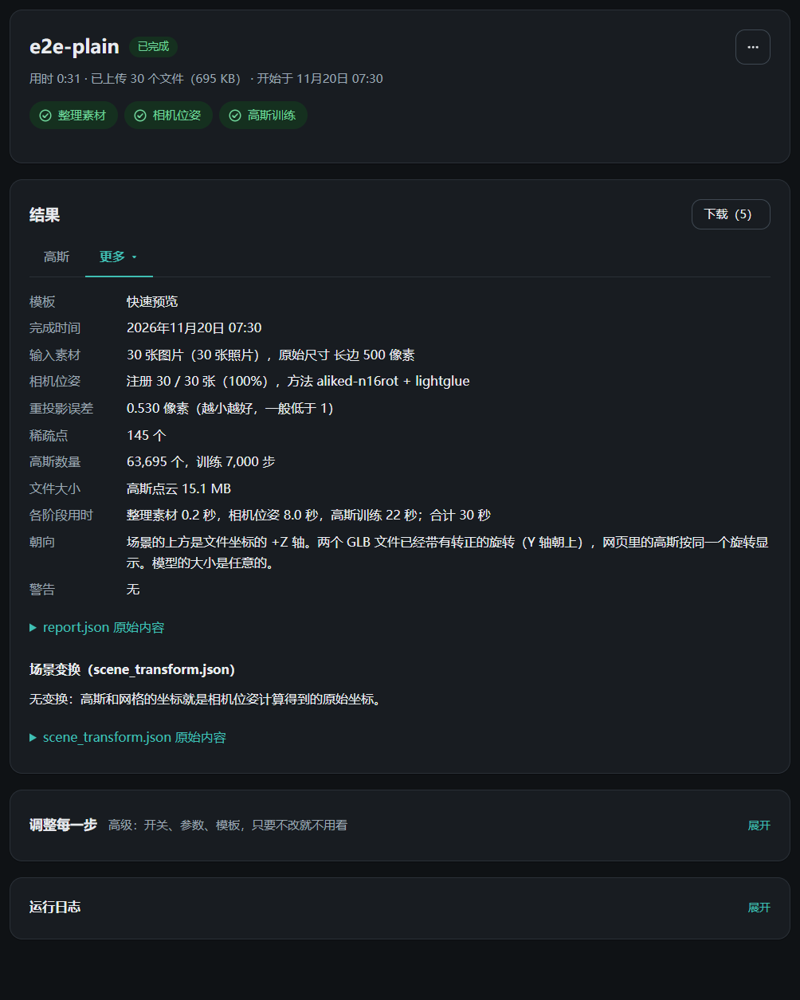
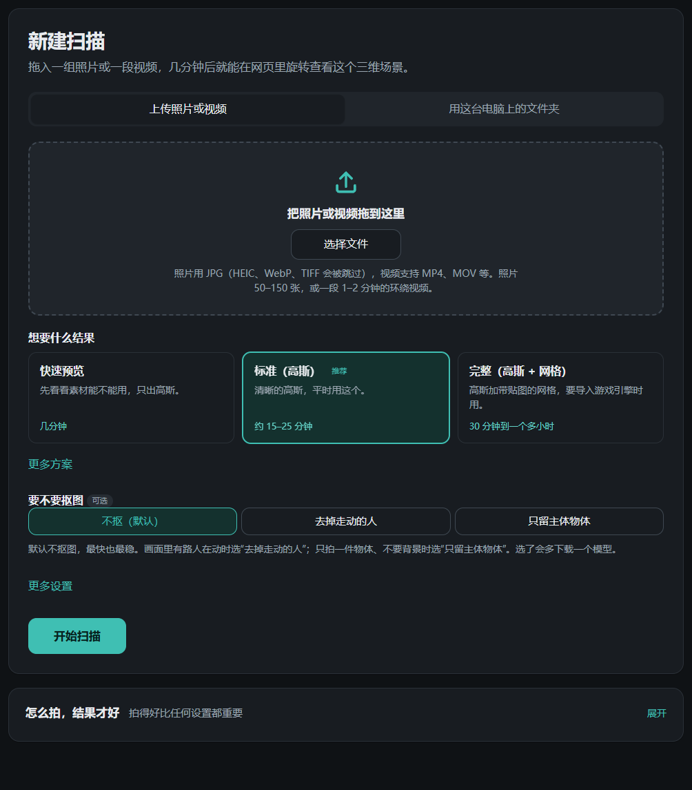
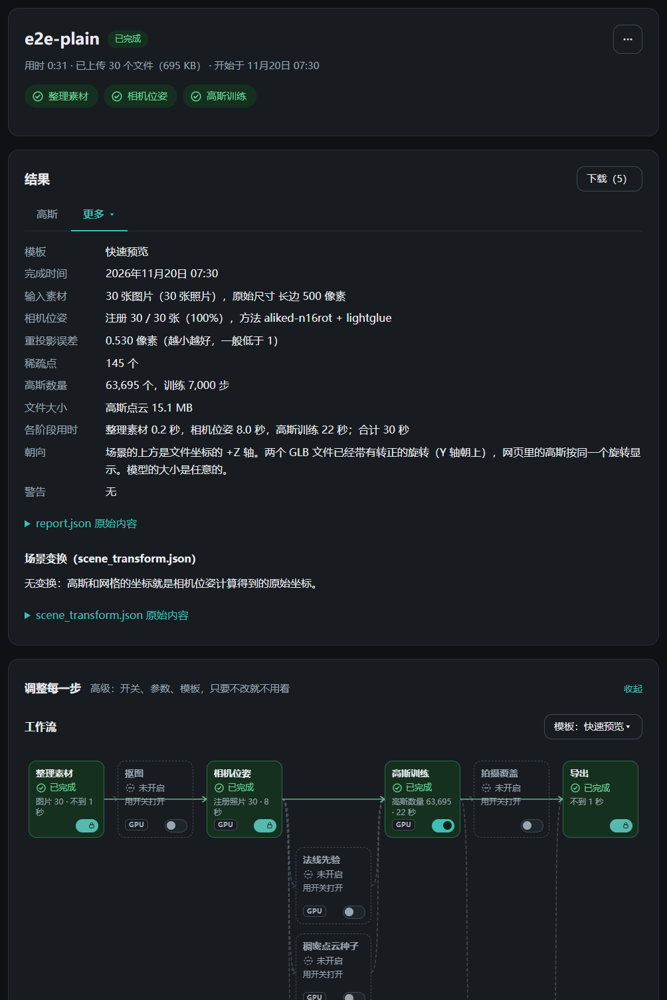

# Scan3D

**Photos or a phone video in → Gaussian splat, textured mesh and collision mesh out. Runs entirely on your Windows PC.**

[English](README.md) · [简体中文](README.zh-CN.md)


-blue)



Scan3D turns a handful of photos or a short video into a 3D scene you can drop into a game
engine or view in the browser. It wires [Spirula Studio](https://github.com/harry7557558/spirula-studio)
(frame selection, masking, camera poses, Gaussian training) and [COLMAP](https://github.com/colmap/colmap)
(dense reconstruction, meshing, photo texturing) into one pipeline with a web UI. No WSL, no
Docker, no cloud upload: double-click one file.

## Why Scan3D

- **Three outputs from one capture.** `splat.ply` (3D Gaussian splat, for looks), `mesh.glb`
  (textured, from your original photos) and `collision.glb` (low-poly, for physics). All three share one coordinate system.
- **Out of the box.** `git clone`, double-click `Scan3D.cmd`. It downloads Python, Spirula Studio and
  COLMAP on first run. Neural network models are fetched when you switch the feature on, from
  the UI.
- **A workflow, not a black box.** Ten independent stages, each with its own switch, parameters,
  log and result. Run up to any stage, re-run one, clear one. Change a parameter and only the
  stages that depend on it are marked stale.
- **See everything in the browser.** Report, splat, mesh, collision mesh, a splat/collision overlay
  to check alignment, and a **capture coverage** view that colours the scene by how well it was photographed
  and tells you where to shoot more.
- **Phone friendly.** One launcher, one URL for this PC and the LAN. Scan the QR code on your
  phone to upload photos and view results (pairing token, loopback needs none).
- **Private.** Nothing leaves your machine except downloading the tools and models.
- **Measured, not claimed.** Every default is backed by numbers in [docs/benchmarks.md](docs/benchmarks.md),
  including the options that did not help and stayed off.

## Quick start

Requirements: Windows 10/11 64-bit, an NVIDIA GPU (developed on a 12 GB RTX 5070 Ti laptop GPU;
others untested), 16 GB RAM recommended, about 6 GB of disk for everything plus 10 GB of scratch
space per scan.

1. Get the code in a folder whose path has **only English characters**:
   ```
   git clone https://github.com/danchar12138/scan3d-windows.git
   ```
   (or Code → Download ZIP and extract it).
2. Double-click **`Scan3D.cmd`**. First run downloads Python, Spirula Studio and COLMAP (about 1 GB;
   re-run to resume if the network drops). Allow Windows Firewall on private networks if asked.
3. Your browser opens. Drop in photos or a video, pick what you want (Quick preview / Standard / Full with mesh; more options under "More options"), press **Start scan**. Masking out people or keeping only one object is optional and off by default.
4. The scan page shows progress, then the result: Gaussian, mesh and capture coverage tabs (collision mesh, overlay and report under "More"), and a **Download** menu. Switches and parameters of every step are under "Adjust each step" at the bottom.

You can also drag a photo folder or a video onto `Scan3D.cmd` to process it with the standard template.





### Templates

| Template | Stages | Time on the test PC |
|---|---|---|
| Quick preview | splat only, 7k steps | a few minutes |
| Quick preview + mesh | quick splat, then a cheap dense reconstruction and a small mesh | about 5 min (31–200 photos) |
| Standard | normal prior, capture coverage, 2M Gaussians, 30k steps | about 13–23 min |
| High | 3M Gaussians, 50k steps | about 2× standard for almost the same score; only for close-up inspection |
| Full | standard + dense reconstruction + mesh | 30 min to over an hour |
| Mesh only | poses, dense reconstruction, mesh (no splat) | depends on photo count |

Templates are starting points; every parameter of every stage can be changed per job, and you can
save your own. Timings are from one machine; see [docs/benchmarks.md](docs/benchmarks.md).

## Outputs

In `runs\<job>\output`:

| File | What | Use |
|---|---|---|
| `splat.ply` | Gaussian splat, standard 3DGS format with view-dependent colour | The result. Open in SuperSplat, Unity/Unreal splat plugins, Blender add-ons |
| `mesh.glb` | Textured mesh | Engines and pipelines without splat support |
| `collision.glb` | Low-poly mesh, no texture | Collision, shadow receiving |
| `report.json` | Timings, statistics, orientation | Debugging, aligning coordinates |

The splat and both meshes use one coordinate system; the GLBs carry a root rotation that makes them
Y-up, recorded in `report.json` as `orientation.rotation_to_y_up_xyzw`. Photos carry no real-world
scale, so scale the model yourself after import (use the same factor for splat and mesh).

## The workflow

| Stage | Does | Needed | GPU |
|---|---|---|---|
| Ingest | order photos; pick sharp, well-spread video frames | yes | no |
| Masks | remove moving people, or keep only the subject | no | yes |
| Camera poses | position and lens of every photo (SIFT, then ALIKED + LightGlue if that fails) | yes | yes |
| Normal prior | MoGe-2 surface normals for flatter splats | no | yes |
| Dense seed | RoMa dense points as training seed (off by default) | no | yes |
| Splat training | train the Gaussian splat (mip anti-aliasing, exposure compensation) | no | yes |
| Dense reconstruction | COLMAP multi-view PatchMatch, the geometry of the mesh (the slow one) | no | yes |
| Mesh | drop fragments, decimate, texture from the original photos, collision mesh | no | no |
| Coverage | mark where photos are too few, suggest where to shoot | no | no |
| Export | collect outputs, build web previews, write the report | yes | no |

Turning a stage on locks the stages it needs. "Run to here" executes only what is missing up to that
node. Each stage stores a fingerprint of its parameters, inputs and upstream stages, so editing the
mesh face count does not redo the dense reconstruction. Before every run the page lists exactly what will
run and which models will be downloaded. A failed stage stops the run; finished stages are kept, nothing is skipped silently.

Every external program runs with a total time limit, a no-output watchdog and cancellation that kills
its whole process tree. Only one GPU stage runs at a time; the rest queue.

## Models and licenses

Some features use third-party neural networks. They are **not** in this repository: switching a
feature on is the only decision; the weights are downloaded when its stage starts (or earlier
from the Models panel), and the licence you accept by enabling it is recorded in
`tools\accepted-licences.json`. The licence name and link are shown on every node.
**Read them before commercial use**: some are restrictive (e.g. SAM License, DINOv3 License).

| Stage | Model | Size | License | Default |
|---|---|---|---|---|
| Masks (people) | SAM 3 | 1.75 GB | [SAM License](https://github.com/facebookresearch/sam3/blob/main/LICENSE) | off; used when you choose "remove moving people" |
| Masks (alternative) | SAM 2.1 + Grounding DINO | 430 + 890 MB | Apache-2.0 | off; switch engine in the node |
| Masks (subject only) | BiRefNet | 424 MB | [MIT](https://github.com/ZhengPeng7/BiRefNet/blob/main/LICENSE) | when "subject only" is chosen |
| Normal prior | MoGe-2 (ViT-B / ViT-L) | 400 MB / 1.3 GB | see [model page](https://huggingface.co/Ruicheng/moge-2-vitb-normal-onnx) | on in Standard/High/Full |
| Dense seed | RoMa v2 (uses DINOv3) | 1.05 GB | [DINOv3 License](https://github.com/facebookresearch/dinov3/blob/adc254450203739c8149213a7a69d8d905b4fcfa/LICENSE.md) + RoMa v2 MIT | off (it lowered PSNR in tests) |
| Pose features | ALIKED + LightGlue | 47 MB | see [COLMAP release](https://github.com/colmap/colmap/releases/tag/3.13.0) | only if SIFT fails |

`scan3d.py models` shows status, `scan3d.py models --download <feature>` downloads ahead of time.
The full list of third-party programs and libraries is in [THIRD_PARTY.md](THIRD_PARTY.md).

## Capture tips

Capture matters more than any parameter: **a blurred photo cannot be repaired by any later step** (measurements in [docs/benchmarks.md](docs/benchmarks.md), "Blurred inputs").

**Photos (recommended)**

- **Plenty of light.** Indoors, switch the lights on; by day, stand near a window. In dim light the phone slows the shutter and hand shake blurs the shot.
- **Normal photo mode, not portrait mode.** Background blur also leaves part of the object itself out of focus. Tap the object to focus, then long-press to lock focus and exposure.
- **Step back.** The object should fill a third to a half of the frame. Very close up the depth of field is shallow and half the object is soft.
- **One shot at a time.** Stand still, wait a second after each shot, move a small step between shots.
- **Enough photos.** 50–150, at least one full circle around the object, one ring at eye level and one from above, neighbouring photos overlapping by 70% or more. Too few photos clearly hurts.
- **White or shiny objects:** put a patterned sheet of paper or cloth under them so poses can be found.
- JPG preferred (PNG and BMP also work); HEIC, WebP and TIFF are skipped.

**Video**

- Plenty of light, lock focus and exposure, use the main camera without zoom; choose H.264 as the video format (best compatibility).
- Walk slowly around the object like a stroll; do not spin on the spot, stop suddenly or turn back.
- 1–2 minutes, one circle is enough; for more coverage do another circle at a different height.
- Hold the phone with both hands, elbows against the body. Blurry frames are dropped automatically, but a video that is blurry throughout cannot be saved.

**After the scan**, open **Capture coverage**: orange means too few photos or one direction only. Shoot there and re-scan with old and new photos together. White walls, glass, mirrors and shiny metal reconstruct poorly, as with all photogrammetry-style methods. Passers-by can be masked out by choosing "remove moving people" in the new-scan form, but fewer is better.

> Dim light (slow shutter), wide aperture (shallow depth of field) and too few photos were measured in this project; the rest is general 3D-capture experience that was not verified item by item here.

## Command line

```
tools\python\python.exe app\scan3d.py run <photos-folder-or-video> [--name JOB] [--template T] [--to STAGE] [--only a,b] [--force a,b]
                                           [--enable a,b] [--disable a,b] [--set stage.param=value] [--fresh]
tools\python\python.exe app\scan3d.py stages [--job JOB]
tools\python\python.exe app\scan3d.py serve [--port 8765] [--no-browser]
tools\python\python.exe app\scan3d.py models [--download [feature]]
tools\python\python.exe app\scan3d.py list | cancel <job> | doctor
```

Re-running an existing job name only does stages that are missing or stale. Exit codes: 0 done,
1 failed, 2 cancelled, 64 invalid arguments or workflow. `--set train.eval_holdout=true` holds out
one eighth of the photos and writes PSNR, SSIM and LPIPS to `report.json`.

## Benchmarks

Measured on one laptop (RTX 5070 Ti, 12 GB) with 30 public datasets, including phone videos.
Highlights (full tables in [docs/benchmarks.md](docs/benchmarks.md), in Chinese; numbers are language-neutral):

- 128 photos of 3072×2304, standard template: **about 13 minutes**, 128/128 registered, 1M Gaussians
  plus a 289k-face textured mesh.
- Halving photo density costs 1.1 dB PSNR; a quarter costs 6.6 dB; 30 photos is not usable. Spacing
  between neighbouring photos matters more than the count.
- Dense seed (RoMa) lowered PSNR by 0.6–1.3 dB in both test scenes, so it stays off. The High
  template took 2× longer for the same score as Standard.
- SAM 2.1 + Grounding DINO matched SAM 3 on a scene with passers-by, and was a little faster.

## Known limitations

- Verified on a single PC and public datasets; not on your phone footage, a real phone over Wi-Fi, or other GPUs.
- Dense reconstruction (and so the mesh) needs an NVIDIA GPU: COLMAP's dense matcher is CUDA-only.
- Generated GLBs pass structure checks and render in the built-in viewer; they have **not** been import-tested in Unity, Unreal or Blender.
- Blurred photos cannot be repaired. Training-time deblurring, 2D deblurring and sharpening, diffusion repair and super-resolution were evaluated: none has a ready-to-use build for this Windows setup, or the licence forbids it, or it measured worse (see [docs/benchmarks.md](docs/benchmarks.md)). Avoid blur when shooting.
- Masking depends on the prompt; too broad a prompt can mask static content.
- Lighting is baked in; the scene cannot be relit. Unphotographed areas are empty.
- The mesh is coarser than the splat: big plain walls become a few large planes, foliage and thin bars stick together. Use the splat for visuals.
- No automatic check for pose "ghosting" on symmetric or repetitive structures.
- Two datasets still fail pose estimation (a 500×375 low-light chair, a long forward-walking video); the cause is unknown.

## Contributing

Issues and pull requests are welcome, see [CONTRIBUTING.md](CONTRIBUTING.md). When reporting a bug, attach the
output of `scan3d.py doctor` and the job's `logs` folder.

## Acknowledgements

Built on [Spirula Studio](https://github.com/harry7557558/spirula-studio), [COLMAP](https://github.com/colmap/colmap),
[three.js](https://threejs.org/), [Spark](https://github.com/sparkjsdev/spark), SAM 3, SAM 2.1, Grounding DINO,
BiRefNet, MoGe-2, RoMa v2, ALIKED and LightGlue. The test scenes come from public datasets
(Mip-NeRF 360, Tanks and Temples, ETH3D, LLFF, Objectron and others). Thanks to all of them.

## License

[MIT](LICENSE) for this repository's code. Downloaded programs and models keep their own licenses, see
[THIRD_PARTY.md](THIRD_PARTY.md).
