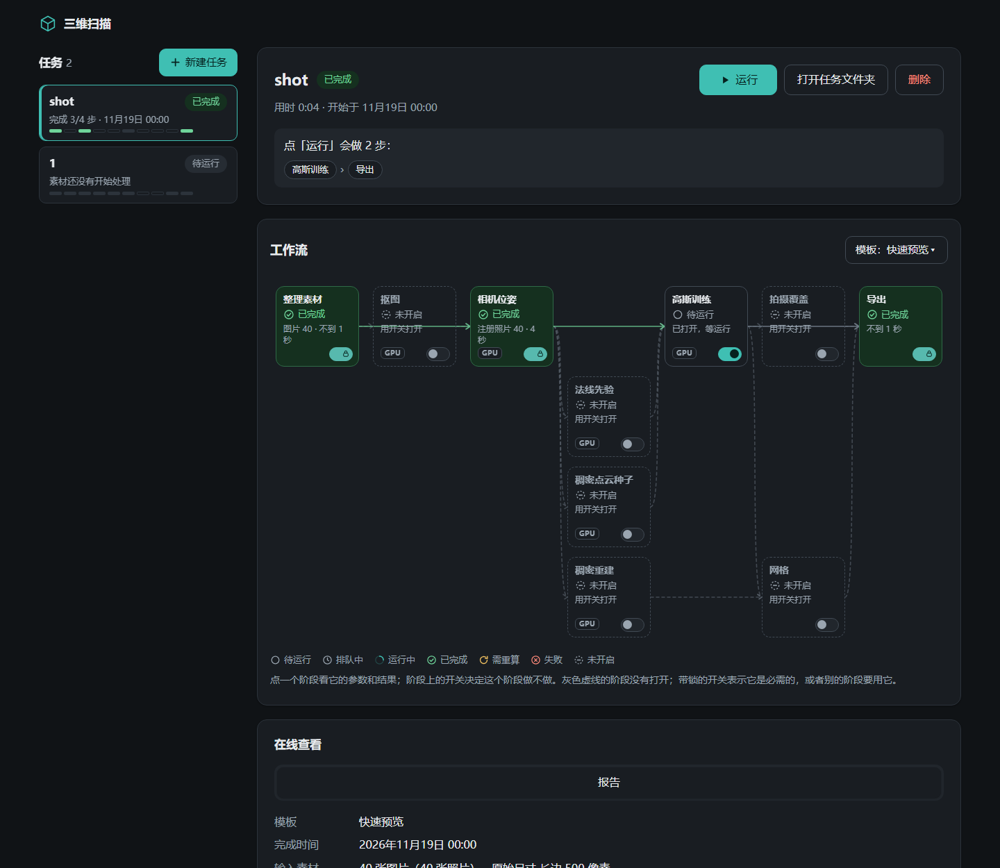

# Scan3D

**简体中文** · [English](README.md)


把一组照片或一段视频变成三维场景：一份高斯泼溅（3DGS，画面用）、一份带贴图的网格和一份低面数碰撞网格（游戏引擎用）。全部在本机运行，不上传任何数据。



> 上图是任务页的工作流图（只跑到相机位姿的一个真实任务）：每个阶段是一个节点，有开关、参数、日志和结果。

这是一个围绕 [Spirula Studio](https://github.com/harry7557558/spirula-studio) 和 [COLMAP](https://github.com/colmap/colmap) 的整合包：取帧、抠图、相机位姿、几何先验、训练高斯由 Spirula 完成；网格由 COLMAP 的稠密重建生成，并用原始照片贴图。本项目负责把这些步骤串成一键流程，并提供网页界面和结果查看器。两个程序都是必需的。

## 系统要求

- Windows 10 / 11，64 位
- NVIDIA 独立显卡（在 RTX 5070 Ti 笔记本显卡、12 GB 显存上开发和测试；其他显卡未测试）
- 磁盘：程序约 1 GB，模型全部装齐约 6 GB；每次扫描处理中临时占用约 10 GB，完成后保留 1–3 GB
- 内存：建议 16 GB 以上（网格贴图时会把照片全部读进内存，最多约 4.5 GB）
- 安装路径只含英文字符（不要放在带中文的文件夹下）

## 开始使用

1. 从 GitHub 下载本仓库（`git clone https://github.com/danchar12138/scan3d-windows.git`，或在页面上点 Code → Download ZIP 解压），放在只含英文字符的路径下，然后双击 `Scan3D.cmd`。第一次运行会自动下载 Python、Spirula Studio 和 COLMAP（合计约 1 GB），断网后重新双击可续传。神经网络模型不用自己找：在网页里打开用到它的功能，运行到那一步时会自动下载；也可以在网页的"模型"面板里提前下载。
2. 浏览器会打开本机页面。新建任务：把照片或视频拖进去，选一个模板（快速预览、快速预览含网格、标准、高质量、完整、只要网格），点开始。
3. 任务页的核心是一张**工作流图**：每个阶段是一个节点，点节点看它的参数、日志和结果，决定它做不做、做到哪一步为止（见下文"工作流"）。结果在页面的"在线查看"里直接看，或下载文件，或打开 `runs\<任务名>\output` 文件夹。

也可以把一个照片文件夹或视频文件直接拖到 `Scan3D.cmd` 上，它会用标准模板直接处理。

**用手机访问。** 只有这一个启动器。启动后本机和局域网都能访问：本机直接打开，不需要任何码；手机连同一个 Wi-Fi，扫页面上"用手机访问"里的二维码（地址里带配对码，重启后不变，可以存为书签）。第一次运行时 Windows 防火墙会询问，选择允许专用网络。下载模型、打开本机文件夹、保存模板这几项只能在电脑上操作。

## 模型与许可

一部分功能用到第三方的神经网络模型。模型不在本仓库里，用到时自动下载到 `tools\models`。**所有模型的用法都一样：你只需要决定用不用这个功能。** 打开对应的节点，运行到那个阶段时缺的模型文件会自动下载，需要的许可由程序记录（`tools\accepted-licences.json`，注明"打开功能时自动记录"和日期，不进仓库），并传给工具。节点面板上会写明模型的许可名称和链接，使用即表示同意该许可。

| 阶段 | 模型 | 大小 | 许可（以来源页面为准） | 默认 |
|---|---|---|---|---|
| 抠图（抠掉走动的人） | SAM 3 | 1.75 GB | [SAM License](https://github.com/facebookresearch/sam3/blob/main/LICENSE) | 标准、高质量、完整模板开启 |
| 抠图（备选引擎） | SAM 2.1 + Grounding DINO | 430 MB + 890 MB | 两者均为 Apache 2.0 | 关闭，在抠图节点里换引擎 |
| 抠图（只留主体） | BiRefNet | 424 MB | [MIT](https://github.com/ZhengPeng7/BiRefNet/blob/main/LICENSE) | 抠图节点选"只留主体"时用 |
| 法线先验 | MoGe-2 (ViT-B / ViT-L) | 400 MB / 1.3 GB | 见[模型页面](https://huggingface.co/Ruicheng/moge-2-vitb-normal-onnx) | 标准、高质量、完整模板开启 |
| 稠密点云种子 | RoMa v2（依赖 DINOv3） | 1.05 GB | [DINOv3 License](https://github.com/facebookresearch/dinov3/blob/adc254450203739c8149213a7a69d8d905b4fcfa/LICENSE.md) 和 RoMa v2 的 MIT | 关闭（原因见[实测数据](docs/benchmarks.md)） |
| 位姿的学习型特征 | ALIKED + LightGlue | 47 MB | 见 [COLMAP 发布页](https://github.com/colmap/colmap/releases/tag/3.13.0) | 常规特征失败时才用 |

命令行里 `scan3d.py models` 查看状态，`scan3d.py models --download 功能` 提前下载。

## 拍摄建议

拍摄方式对结果的影响比任何参数都大。

- 围绕场景慢慢移动，相邻两张照片至少七成画面重叠。
- 同一个地方从不同高度各拍一圈（平视一圈，俯视一圈）。
- 照片 50–300 张，或一段 1–2 分钟的视频。视频会自动挑出清晰的画面。
- 照片格式用 JPG（PNG、BMP 也可以）。HEIC、WebP、TIFF 会被跳过。
- 光线均匀，避免对着窗户或灯。能锁定曝光和对焦就锁定。
- 路过的行人会被自动抠掉，但尽量在人少的时候拍。白墙、玻璃、镜子、反光的金属会重建得差，这是这类技术的共同限制。
- 扫完后看一下"在线查看"里的"拍摄覆盖"：橙色的地方照片太少或只从一个方向拍过，按提示补拍，再把新旧照片放在一起重新扫描。

## 工作流

一次扫描不是"一键跑完"，而是十个**独立阶段**，每个都能单独运行、单独重跑、单独清除：

| 阶段 | 做什么 | 必需 | 用显卡 |
|---|---|---|---|
| 整理素材 | 照片按顺序整理；视频挑清晰的帧，丢掉模糊的 | 是 | 否 |
| 抠图 | 抠掉走动的人，或只留主体（物体模式，背景不重建） | 否 | 是 |
| 相机位姿 | 每张照片的位置和镜头参数 | 是 | 是 |
| 法线先验 | MoGe-2 估计表面法线，高斯更平整 | 否 | 是 |
| 稠密点云种子 | RoMa 稠密点云作为训练初始点（默认关） | 否 | 是 |
| 高斯训练 | 训练高斯泼溅 | 否 | 是 |
| 稠密重建 | COLMAP 多视角稠密匹配，网格的几何（最慢，约半小时） | 否 | 是 |
| 网格 | 去碎片、减面、照片贴图、碰撞网格 | 否 | 否 |
| 拍摄覆盖 | 标出哪里照片太少，给出补拍位置 | 否 | 否 |
| 导出 | 整理输出文件、网页预览、报告 | 是 | 否 |

- **每个节点有开关**。打开一个阶段，它依赖的阶段会自动锁定为开（带锁的开关）。
- **走到哪一步**：点某个节点的"运行到这里"，只跑它和它需要的、还没做完的阶段。比如只要高斯，就运行到"高斯训练"，之后想要网格，再打开"网格"运行，已经完成的阶段不会重做。
- **只运行这一步 / 重新运行 / 清除结果**：重新运行会连带重做依赖它的阶段；清除结果只删这一个阶段的产物。
- **改了参数哪些会过期**：每个阶段记录自己的"指纹"（参数、输入、上游阶段）。改一个参数，只有这个阶段和依赖它的阶段显示"需重算"。例如改网格面数，不会重做稠密重建。
- **运行前会告诉你要做什么**：页面上方列出下一次点"运行"会执行的阶段和需要下载的模型。

**模板**是起点，每个任务的每个参数都可以在节点面板里单独改（视频取帧数、抠图提示词、训练步数、高斯数量、网格面数、贴图尺寸等），改完可以"存为模板"，也可以设为默认。用户模板保存在 `user-settings.json`（不进仓库）。

| 模板 | 开启的阶段 | 说明 |
|---|---|---|
| 快速预览 | 整理素材、相机位姿、高斯训练、导出 | 1280 像素、7000 步、50 万高斯，几分钟，只出高斯 |
| 快速预览（含网格） | 快速预览，加稠密重建和网格 | 高斯同快速预览；稠密匹配 800 像素、最多 60 张、每张 6 张邻图、不做几何一致性检查；网格 10 万面、2048 贴图。用来先看网格能不能用。稠密点数约为完整模板的四分之一，面数三分之一，贴图小一半，用时 5 分钟左右（见[实测数据](docs/benchmarks.md)）；网格的细节没有做定量比较，要交付请用完整模板 |
| 标准（高斯） | + 抠图、法线先验、拍摄覆盖 | 1920 像素、3 万步、200 万高斯，不做网格 |
| 高质量（高斯） | 同上 | 3072 像素、5 万步、300 万高斯。在 bonsai_half 上用时是标准模板的两倍多，指标几乎相同（见[实测数据](docs/benchmarks.md)），只在需要放大细看时才值得 |
| 完整（高斯 + 网格） | 标准 + 稠密重建、网格 | 要一个多小时 |
| 只要网格 | 抠图、位姿、稠密重建、网格 | 不训练高斯，网格在照片坐标系里 |

高斯都用 mip 抗锯齿（`--primitive mip`）。"稠密重建"的耗时不随模板变，约半小时（130 张 3072×2304 照片、200 张取样、长边 1600）；网格阶段的面数和贴图大小只影响最后的减面和贴图，几十秒。

## 输出文件

在 `runs\<任务名>\output` 下：

| 文件 | 内容 | 用途 |
|---|---|---|
| `splat.ply` | 高斯泼溅，标准 3DGS 格式，含随视角变化的颜色 | 最终成品。用 SuperSplat、Unity / Unreal 的高斯插件、Blender 插件等打开 |
| `mesh.glb` | 带贴图的网格 | 不支持高斯的引擎和传统流程 |
| `collision.glb` | 低面数网格，无贴图 | 碰撞、接收阴影 |
| `preview.spz`、`preview-lite.spz` | 高斯的压缩副本 | 只给网页查看器用，丢了会自动重新生成 |
| `report.json` | 各阶段用时、统计数字、朝向信息 | 排查问题、对齐坐标 |

**坐标对齐。** 三个模型文件的坐标是同一套：`splat.ply` 里的点 (x, y, z) 和两个 GLB 里的顶点 (x, y, z) 指的是同一个位置。两个 GLB 在根节点上带了一个旋转，让它们在查看器和引擎里是正立的（Y 轴朝上）。这个旋转记录在 `report.json` 的 `orientation.rotation_to_y_up_xyzw` 里，把同一个旋转加到高斯上，高斯和网格就重合。

**尺寸。** 照片里没有真实尺寸信息，模型的大小是任意的。导入引擎后需要自己缩放到合适大小，高斯和网格用同一个缩放值。

**网格的质量。** 网格来自 COLMAP 的多视角稠密重建（不是从高斯里提取的），贴图直接取自原始照片，所以砖缝、窗格这类细节是清楚的，天空也不会被做成网格。它仍比高斯粗糙：大面积的纯色白墙会变成几块大的平面，树叶和细栏杆会粘连；树挡在墙前的地方，墙上可能印上树叶。画面请优先用高斯。

## 在线查看

任务完成后，任务页的"在线查看"里有六个标签：报告、高斯、网格、碰撞网格、叠加对齐（高斯和碰撞网格叠在一起，用来确认两者重合）、拍摄覆盖。鼠标或手指拖动旋转，滚轮或双指缩放。

**拍摄覆盖**把高斯按被拍到的程度染色：蓝色拍得充分（至少 8 张照片、3 个方向），黄色一般，橙色不足（少于 3 张或只从一个方向），灰色未判断。计算时考虑了遮挡。白点是每张照片的拍摄位置。下方列出最多五处不足的区域，"从这里补拍"会把视角移到建议的站位。完全没拍到的空洞没有东西可以染色，所以不会显示；天空总是显示为充分。在室外样例上，橙色区域里 22/30 的画面小块在新视角下明显损坏，蓝色区域里是 7/30。

高斯有三档画质：

| 档 | 内容 | 大小（100 万个高斯） | 默认用在 |
|---|---|---|---|
| 轻量 | 最多 30 万个高斯，不带随视角变化的颜色 | 约 5 MB | 窄屏（手机） |
| 完整 | 全部高斯，带全部随视角变化的颜色，压缩过 | 约 40 MB | 宽屏（电脑） |
| 原画质 | 直接加载 `splat.ply`，与成品完全一致 | 约 236 MB | 不默认；窄屏上加载前会提示 |

在测试场景上，"完整"与"原画质"从同一机位渲染的差别是平均每像素 1.4/255，肉眼基本看不出。

## 命令行

```
tools\python\python.exe app\scan3d.py run <照片文件夹或视频> [--name 任务名] [--template 模板] [--to 阶段] [--only 阶段,阶段] [--force 阶段,阶段]
                                            [--enable 阶段,阶段] [--disable 阶段,阶段] [--set 阶段.参数=值] [--fresh]
tools\python\python.exe app\scan3d.py stages [--job 任务名]    各阶段的状态
tools\python\python.exe app\scan3d.py serve [--port 8765] [--no-browser]
tools\python\python.exe app\scan3d.py models [--download [功能]]
tools\python\python.exe app\scan3d.py list | cancel <任务名> | doctor
```

- 用已有的任务名再次运行会读取这个任务的工作流，只做没完成或已过期的阶段；`--fresh` 清空这个任务的结果重来。
- `--to train` 只跑到高斯训练；`--only mesh` 只重做网格；`--force train` 强制重训。
- `--set 阶段.参数=值` 临时改参数，例如 `--set train.iterations=7000`、`--set masks.kind=subject`、`--set train.eval_holdout=true`（留出八分之一照片，结束后在 `report.json` 里给出 PSNR、SSIM、LPIPS，用来比较参数）。
- 退出码：0 完成，1 失败，2 取消，64 参数或工作流不合法。

## 设置

简单的开关和数字都在网页里改（每个节点的参数、模板），不需要改文件。`app\settings.json` 只留不是简单开关的东西：图片数量上限、视频相似帧参数、模型文件名、位姿计算依次尝试的特征类型、各步骤的超时。

## 处理流程

1. **整理素材**：照片统一命名（不重新编码，保留拍摄参数）；视频由 Spirula 挑出清晰且分布均匀的画面，丢掉运动模糊的帧。
2. **抠图**（可选）：SAM 3 按提示词抠掉走动的人，或 BiRefNet 只留主体，写出遮罩；位姿、训练、稠密重建和网格贴图都避开遮罩区域。
3. **相机位姿**：Spirula 的位姿计算，不用照片里的 GPS 定尺度（定了尺度后模型缩到极小，COLMAP 的稠密匹配会崩溃）。注册的照片不够时，换学习型特征（ALIKED + LightGlue）再算一次。
4. **法线先验 / 稠密点云种子**（可选）：MoGe-2 为每张图估计表面法线；RoMa 稠密点云。
5. **高斯训练**（可选）：Spirula，mip 抗锯齿高斯，带曝光和白平衡补偿，直接使用带镜头畸变的相机模型，不做去畸变。
6. **稠密重建**（可选）：COLMAP 去畸变，GPU 上的 PatchMatch 稠密匹配（每张图按共享点数指定参考图，与其他照片没有共享点的照片会被剔除），融合成点云，用 Delaunay 方法建面，被遮罩的像素不参与。
7. **网格**（可选）：挪到高斯的坐标系（没有高斯则在照片坐标系），去掉碎块和远处的碎片面，减面到预算；再用原始分辨率照片贴图（带接缝颜色均衡，遮罩区域不取色），打包成 GLB。碰撞网格是同一表面减到更低面数。
8. **拍摄覆盖**（可选）：统计每处被几张照片、从几个方向拍到，写出补拍建议。
9. **导出**：整理输出文件，生成网页预览，写报告。只有哪个阶段做过，就导出哪个阶段的结果。

每个外部程序都有三重保护：总时长上限、长时间无输出自动终止、可随时取消；终止时连同它启动的子进程一起结束。同一时间只有一个用显卡的阶段在运行，其余排队。一个阶段失败，整次运行停在那里，之前完成的阶段保留，不会被悄悄跳过。

## 实测数据

在 RTX 5070 Ti 笔记本显卡上测得的完整数据（30 套样例、拍摄完整度、各功能开关、网格方案对比、各模板用时）放在 [docs/benchmarks.md](docs/benchmarks.md)。

## 已知限制

- 只在一台电脑（RTX 5070 Ti 笔记本显卡）上验证过，用的是 30 套公开素材（其中有手机视频），没有用你自己的手机直接拍的素材验证过。
- 手机端只在电脑上用手机尺寸的浏览器窗口模拟过，没有用真实手机和真实 Wi-Fi 测试；手机上"完整"和"原画质"两档的内存占用和流畅度未知。
- 生成的 GLB 通过了结构检查并能在网页查看器里显示，但没有在 Unity、Unreal、Blender 里实际导入验证。
- 抠图依赖提示词。提示词写得太宽（例如把"car"加进去）会把静止的场景内容也抠掉；平均遮挡超过三成时任务会给出警告。
- 场景的光照是拍摄时固定下来的，放进引擎后不能重新打光。
- 没拍到的地方是空的；离拍摄路径越远，高斯的画面越差。"拍摄覆盖"能指出照片不足的地方，但它建议的补拍位置是推算的，没有验证过补拍后一定能修好。
- 稠密重建需要 NVIDIA 显卡（COLMAP 的稠密匹配只有 CUDA 版本），并且比高斯训练还慢，约 30 分钟。
- 位姿计算没有自动检测"结构叠错"的手段：对称的建筑、重复的结构有可能被错误地叠在一起而不报错。

## 第三方组件

安装脚本从各项目的官方发布地址下载以下程序，本项目通过命令行调用它们，不包含也不修改它们的代码：

| 组件 | 版本 | 用途 | 许可 |
|---|---|---|---|
| Spirula Studio | 2026.11.12 | 取帧、抠图、相机位姿、几何先验、训练高斯 | GPL-3.0 |
| COLMAP（CUDA 版） | 4.2.1 | 稠密重建、建面、减面、照片贴图 | BSD-3-Clause |
| Python | 3.12.10 embeddable | 运行本项目的代码 | PSF |

网页查看器用到的脚本库放在 `app\web\vendor`（未修改的发布文件，版本、来源和校验值见该目录的 README）：three.js、Spark（`@sparkjsdev/spark`）、qrcode-generator，均为 MIT 许可。

本项目自己的代码使用 [MIT 许可](LICENSE)；下载的程序和模型各自保持自己的许可，完整清单见 [THIRD_PARTY.md](THIRD_PARTY.md)。如果要把这套东西连同 Spirula Studio 一起分发，请遵守它的 GPL-3.0；商业使用结果前请先看各模型的许可。

## 参与和反馈

欢迎提 issue 和 PR，见 [CONTRIBUTING.md](CONTRIBUTING.md)。报告问题时请附上 `scan3d.py doctor` 的输出和任务的 `logs` 文件夹。
